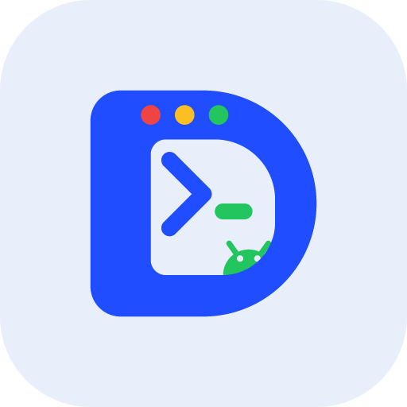

# Dterm

[](https://github.com/Howardyh/dterm/releases)
[](LICENSE)

**中文** · [English](README.en.md)

**把 Termux 里的 DeepSeek Harness 包装成一个真正能用的 Android 应用。**

Dterm 不是把 DSH 塞进 APK，而是一个 46 KB 的全屏外壳：桌面有独立图标、没有地址栏、
返回手势正常，直接连本机 `127.0.0.1:3080` 上的 DSH 服务。真正的 DSH 仍然跑在
Termux + PRoot Ubuntu 里，Dterm 负责把「打开它」这件事做得像一个应用。

<p align="center"></p>

## 特性

| | |
| --- | --- |
| **零操作登录** | 本机令牌桥把一次性启动令牌交给应用，换到 30 天有效 Cookie；取不到才退回手动粘贴 |
| **服务一键启动** | 通过 Termux 的 `RUN_COMMAND` 执行 `dsh-start`，在 Termux 里能看到进度输出 |
| **自动回到前台** | 命令结束后由 Termux `am start` 把 Dterm 拉回，不用手动切换 |
| **长按快捷菜单** | 重新加载 / 在浏览器打开 / 打开 Termux |
| **附件与下载** | 系统文件选择器上传，下载落到 `Download/DSH/` |
| **语音输入** | 网页里的 `getUserMedia` 走系统麦克风授权 |
| **原生兜底界面** | 服务未运行、需要登录、渲染进程崩溃，都有对应的原生页面，而不是白屏 |
| **系统级细节** | 深色模式实时跟随、Android 12+ 启动画面、Android 13 主题图标、预测性返回 |

## 它是怎么工作的

### 1. 登录：Cookie → 令牌桥 → 粘贴

`dsh web` 每次启动都会随机生成一个启动令牌，并把带令牌的地址写进
`~/.local/state/dsh/web.log`；浏览器靠它换 30 天有效的签名 Cookie。

Dterm 启动时先带 Cookie 请求 `/`：

- `200` → 已登录，直接加载；
- `401` → 向 `127.0.0.1:3081/token` 要当前令牌（共享密钥鉴权），再加载 `/?token=…`；
- 令牌桥不可用时，才显示粘贴界面。

令牌桥是 `server/dsh-token-bridge`，由 `server/dsh-web-service` 随 DSH 一起拉起，
只监听回环地址，按需读取 `web.log`，所以 DSH 重启不需要动它。

### 2. 启动：Termux RUN_COMMAND

服务没在跑时，点「启动 DSH」会把一条命令交给 Termux：

```bash
printf '▸ Dterm：正在启动 DSH…'
dsh-start
printf '▸ 已就绪，正在返回 Dterm…'
am start -n dev.dsh.pad/dev.dsh.pad.MainActivity
```

Termux 在可见会话里执行并打印进度，跑完自己把 Dterm 拉回前台。应用同时在后台轮询
`127.0.0.1:3080`，最长等 2 分半。

## 目录结构

```
app/        Android 工程（无 Gradle）：清单、Java、资源、构建脚本、图标生成器
server/     本机服务端：令牌桥 + dsh-web-service 包装脚本
termux/     Termux 侧快捷方式示例
docs/       安装说明、图标
release/    已构建的 APK
```

## 安装

1. 下载 `release/Dterm-1.4.4.apk`，允许「未知来源」安装；
2. 保证 Termux 里的 DSH 服务在运行（`dsh-start`）；
3. 打开 Dterm，正常情况下直接进界面。

详细步骤和排查见 [`docs/install.md`](docs/install.md)。

用「启动 DSH」需要 Termux 放行一次：

```bash
echo 'allow-external-apps=true' >> ~/.termux/termux.properties
termux-reload-settings
```

## 从源码构建

刻意没有用 Gradle：整套流程在 arm64 的 PRoot Ubuntu 里也能跑。

需要：

- JDK 17
- Android SDK 的 `build-tools;34.0.0`（用其中的 `d8`、`apksigner`）和 `platforms;android-34`
- **aarch64 版 aapt2**（Debian 的 `aapt` 包提供；官方 build-tools 里的是 x86_64，跑不了）

```bash
cd app
ANDROID_SDK_ROOT=/path/to/sdk JAVA_HOME=/path/to/jdk \
AAPT2=/path/to/aapt2 bash build.sh
```

`build.sh` 依次做：生成图标 → `aapt2 compile/link` → `javac` → `d8` → 手写 zip 组装
（`tools/assemble.py`，替代跑不了的 `zipalign`）→ `apksigner` 签名。
签名密钥默认在 `/opt/dsh-build/keys`，可用 `DSH_KEYDIR` 覆盖。

## 版本历史

见 [CHANGELOG.md](CHANGELOG.md)。当前 1.4.4。

## 已知限制

- 只能连本机回环地址；不支持远程 DSH 实例。
- 通过 JS `blob:` 触发的下载走不到 `DownloadListener`，需要「在浏览器打开」。
- 没有下拉刷新；页面卡住用长按图标的「重新加载」。
- 「启动 DSH」依赖 Termux 的 `RUN_COMMAND` 与 `allow-external-apps`；
  拿不到权限时会退回「打开 Termux」。

## 安全说明

- 令牌桥只监听 `127.0.0.1`，要求 `Authorization: Bearer <密钥>`；密钥在构建时写入 APK。
  能装到设备上的应用理论上可以解包取出，信任级别约等于「浏览器里的 DSH Cookie」，
  适合个人设备。
- 仓库里**不包含**任何密钥：签名密钥、`bridge.secret`、生成的 `BuildSecrets.java`
  都被 `.gitignore` 排除。

完整信任模型见 [SECURITY.md](SECURITY.md)；英文安装说明见
[`docs/install.en.md`](docs/install.en.md)。

## 许可

MIT，见 [LICENSE](LICENSE)。
